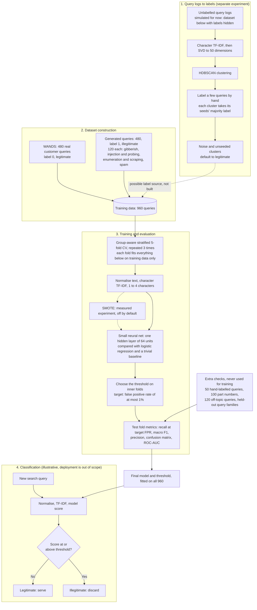

# bot-query-classifier
Tell apart real search queries from one coming from bot traffic

The classifier decides from the query text alone whether to serve a search query or discard it. The use case is a furniture and home-goods shop. The costly mistake is discarding a real shopper's query, because that can lose a sale, so the false positive rate is capped first and bot detection is maximised within that cap.

> **Status:** this diagram shows the planned design. The project is at an early stage: 3 of 36 tasks are validated, no model has been trained, and there are no results yet. Numbers below are design parameters and targets, not measurements.

## How it works

Solid lines are the planned pipeline. Dashed lines are optional or not built.
