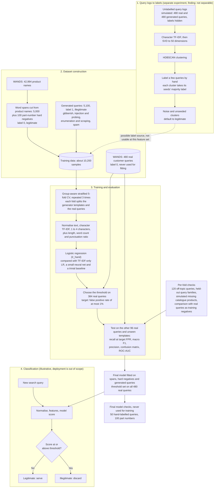

# bot-query-classifier

Tell apart real search queries from ones coming from bot traffic.

The classifier decides from the query text alone whether to serve a search query or discard it. The use case is a furniture and home-goods shop. The costly mistake is discarding a real shopper's query, because that can lose a sale, so the false positive rate (FPR) is capped first and bot detection is maximised within that cap.

> **Status: closed, design v2.8.** Every planned milestone (M1 to M7) is implemented, validated and signed off. The recommended model is `lr_hand`, a logistic regression on character TF-IDF plus three hand features, chosen by a pre-registered rule from the final run of 2026-11-07. All numbers below come from that run and are recorded, with their sources, in `PLAN.md` (the M6.T1 and M7.T7 reports) and `DESIGN.md` (sections 12 and 13). The run outputs themselves live under `results/`, which is not committed.

## The problem and the data

- **Legitimate queries:** the 480 real customer queries of the public WANDS dataset (Wayfair), the only real negatives available. They are never trained on: they set the decision threshold and they are the FPR test set (`DESIGN.md` 8.2).
- **Training negatives:** 5,000 word spans cut from WANDS product names (`DESIGN.md` 3.2), plus 100 generated part-number hard negatives such as `ines shag rug w003096809` (3.3), because part numbers are legitimate by the taxonomy but WANDS has no bare part-number query.
- **Positives:** generated by templates in five families (`DESIGN.md` section 2): A gibberish, B injection and probing payloads, C enumeration and scraping, D spam and promotional, E off-topic natural language. A to D train; E is evaluation-only. Each family has six templates, at least two of which embed real product words.
- **Hand-labelled sanity set:** 50 queries written by the agents and labelled blind by the user, never used for fitting (8.6.1).

## Final model architecture

`lr_hand` (`bqc/models.py`, `DESIGN.md` 6.5), behind the project's `Scorer` port:

1. **Normalise** the text once: control and format characters removed, Unicode NFKC, lowercase, NFKC again, whitespace collapsed, truncated at 512 code points (`bqc/preprocess.py`, section 5).
2. **Features**, concatenated as one sparse matrix:
   - character TF-IDF, 1- to 4-grams, sublinear term frequency, `min_df=2`, fitted on the training rows only (`bqc/features.py`);
   - three hand features standardised on the training rows: character length, word count, non-alphanumeric ratio.
3. **Estimator:** `LogisticRegression(C=1.0, max_iter=1000)`.
4. **Decision:** the threshold `t` is the smallest score whose FPR on the real queries is at or below 1%; a query is illegitimate when `score >= t` (8.4).

Three other models run in the same harness for comparison: `lr` (TF-IDF only), `mlp` (one hidden layer of 64 units, the model the project started with) and `trivial` (the three hand features alone, an artefact detector).

## Observed metrics

Primary arm (spans as training negatives), 5-fold group-aware cross-validation repeated 3 times, pooled over the 15 folds; recall is on the test-side positives of families A to D, FPR on the 480 real queries with a Wilson 95% interval (`PLAN.md`, M7.T7 report, run `evaluate-baef3189eaa6-20261107T121450246509Z.json` at commit `4d19467`).

| Model | Recall at FPR <= 1% | Achieved FPR (95% CI) | Pooled ROC-AUC |
|---|---|---|---|
| `lr_hand` (recommended) | 81.9% | 0.69% (0.25 to 1.92%) | 0.953 |
| `lr` | 75.3% | 0.62% (0.21 to 1.82%) | 0.973 |
| `mlp` | 73.5% | 0.83% | 0.967 |
| `trivial` | 61.1% | 0.76% | 0.854 |

Paired comparisons under the rule of `DESIGN.md` section 7 (first-named minus second-named over the 15 folds; a gain counts only if it exceeds twice its standard error and the FPR does not rise):

- `lr_hand` minus `lr`: recall +6.2 points (standard error 2.5, 12 of 15 folds), FPR gate holds, **justified**.
- `mlp` minus `lr`: recall -1.8 points, within fold-to-fold noise; the MLP is not justified over logistic regression.
- Spans minus real queries as training negatives: justified for `lr`, `mlp` and `trivial` (`DESIGN.md` 12.1 item 13 confirmed).

Generalisation checks (`DESIGN.md` 8.6), `lr_hand` in the primary arm:

| Check | Result |
|---|---|
| Leave-one-family-out recall (threshold chosen without the family) | A 78.3%, B 49.7%, C 82.5%, D 70.8% (`lr`: 61.1%, 37.9%, 69.3%, 22.8%) |
| Family E, off-topic natural language, never trained on | 9.0% caught (`lr`: 19.6%) |
| Catalogue-gap check (products of the test queries' classes removed) | pooled FPR 0.49%, passes the rule |
| Part-number diagnostic (100 generated part numbers, legitimate) | 61% flagged (`lr`: 78%; before the hard negatives: 85%) |
| Sanity set, 50 hand-labelled rows, confusion matrix [[TN, FP], [FN, TP]] | [[34, 3], [3, 10]]; the two `SKU...` rows are still flagged |
| One-word real queries flagged | 2 of 23 |
| False positives reviewed by eye | none looks machine-generated |

Known weaknesses of `lr_hand`, recorded for the next piece of work (`DESIGN.md` section 14): lower ranking quality than `lr` (AUC 0.953 against 0.973), the `C.walk` template falls from 80% to 23%, family E halves, and its false positives are long ordinary product titles, which is the length artefact the trivial baseline measures.

## The experiment's journey

1. **v1 design (2026-11-05).** Real WANDS queries as training negatives, generated positives, an MLP against a logistic regression baseline, group-aware folds so no template or query straddles a fold, thresholds chosen on real queries, and a list of anti-inflation checks. Every decision and probe was written down first (`DESIGN.md`, `PLAN.md`), and each task went through implement, validate with a mutation pass, and sign off.
2. **Probes before models.** Scratch probes settled the vectoriser, the folds, HDBSCAN on TF-IDF, SMOTE (generates nothing on a balanced set), and the Wilson interval (`DESIGN.md` section 13). SMOTE, LLM-generated positives, embeddings and SVD for the classifier were each considered and rejected on evidence (12.1).
3. **Q13: product-name spans (v2.0).** A probe showed real queries are too few to be training negatives; spans cut from product names with the queries' length distribution transfer (0.2% FPR against 18% for whole names) and 5,000 of them capture most of the gain of 40,000 (13.19). The real queries moved to threshold-setting and testing only, and a catalogue-gap check was added for the new failure mode.
4. **M1 to M5: the harness.** Loaders with checksums, the sanity set labelled blind, generators with a taxonomy and an exact-match audit, the evaluation harness against a fake scorer (leave-one-family-out, catalogue gap, final models, sanity and part-number sections, paired comparisons), the three adapters, the `evaluate` command, and the HDBSCAN label-discovery experiment.
5. **M6: the first full run (2026-11-06).** Logistic regression matched the MLP within noise while the MLP failed the FPR gate, so logistic regression became the recommendation (12.1 item 18). Two findings drove the next milestone: held-out-family recall of `lr` was low on B and D while the trivial length-and-punctuation baseline transferred better, and 85% of generated part numbers were flagged although part numbers are legitimate.
6. **M7: the response (2026-11-07).** Reworking the generators was considered and rejected: it would lower the yardstick without changing what the classifier can see. Instead the three hand features were added to the logistic regression (`lr_hand`), and 100 part-number hard negatives joined the training side. The re-run made `lr_hand` justified over `lr` with held-out recall up on every family, and the part-number diagnostic improved where the fix could work; the costs are listed above.
7. **Label discovery without labels (section 9).** Clustering the pooled queries with labels hidden does not separate the classes at this feature set: at the default cell HDBSCAN gives 2 clusters, 1.5% noise and an adjusted Rand index of 0.002, and the seed-labelling rule is at chance. Recorded as a finding; the no-label scenario needs behavioural features, which are outside this project.

## How it works



Solid lines are the pipeline as built. Dashed lines are not usable in this project.

## Running it

```
python -m venv .venv && .venv/bin/pip install -e .
.venv/bin/python -m bqc fetch        # WANDS query.csv and product.csv, checksums verified
.venv/bin/python -m bqc generate     # the training set and its audit report
.venv/bin/python -m bqc evaluate --negatives product,real --lofo --catalogue-gap
.venv/bin/python -m bqc cluster      # the label-discovery experiment
.venv/bin/python -m unittest discover -s tests
```

Every run writes one JSON file under `results/` with the configuration, seed, git commit and library versions, and `evaluate` pickles one final model per arm and model next to it. Two runs with the same configuration give identical JSON apart from the timestamp and the measured fit time. The full `evaluate` invocation with four models took about 80 minutes on 4 cores (`DESIGN.md` 13.9); the test suite takes about 4 minutes.

Dependencies: `numpy` and `scikit-learn`. The workflow that built it (design, plan, implement, validate, sign off, with the roles in `.claude/agents/`) is described in `CLAUDE.md`.
